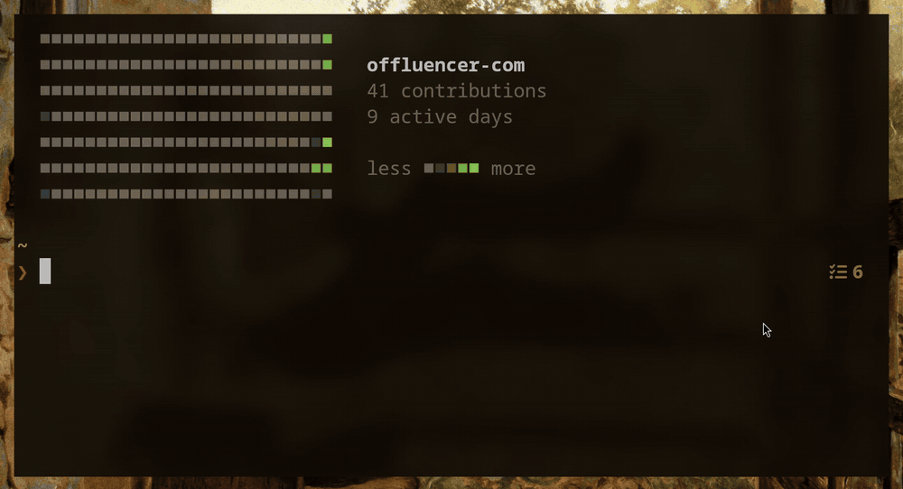
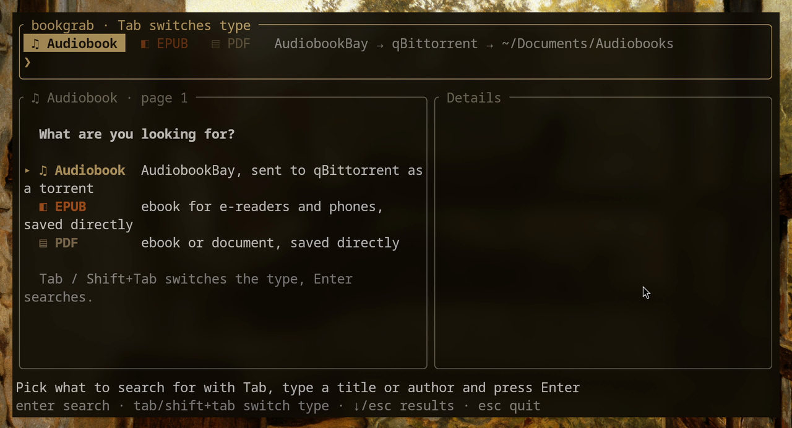
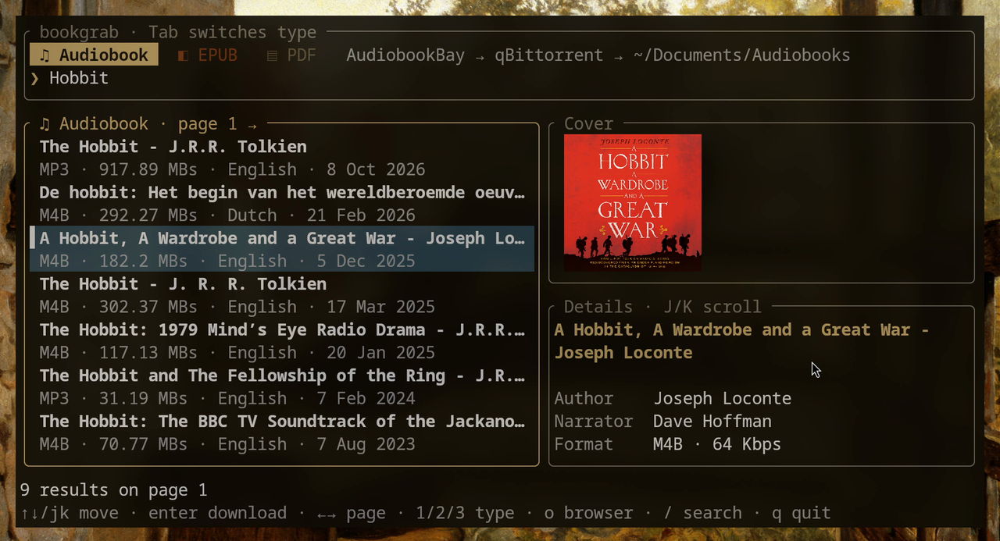
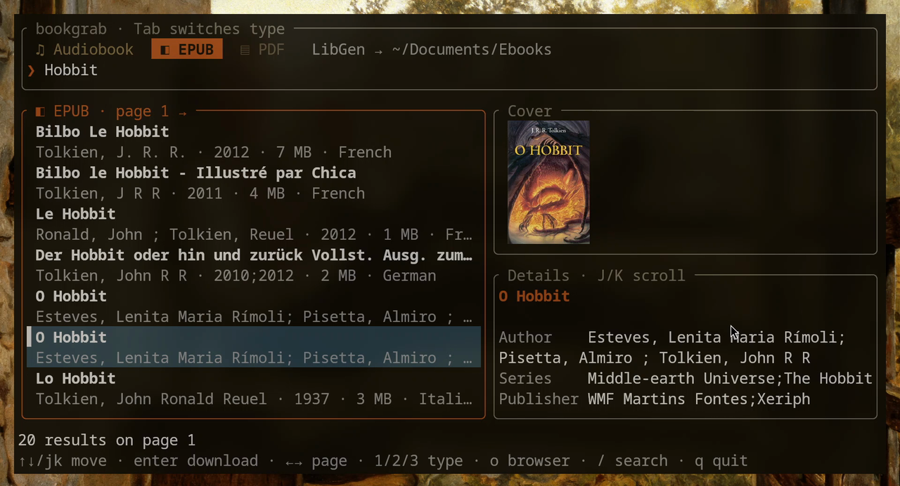
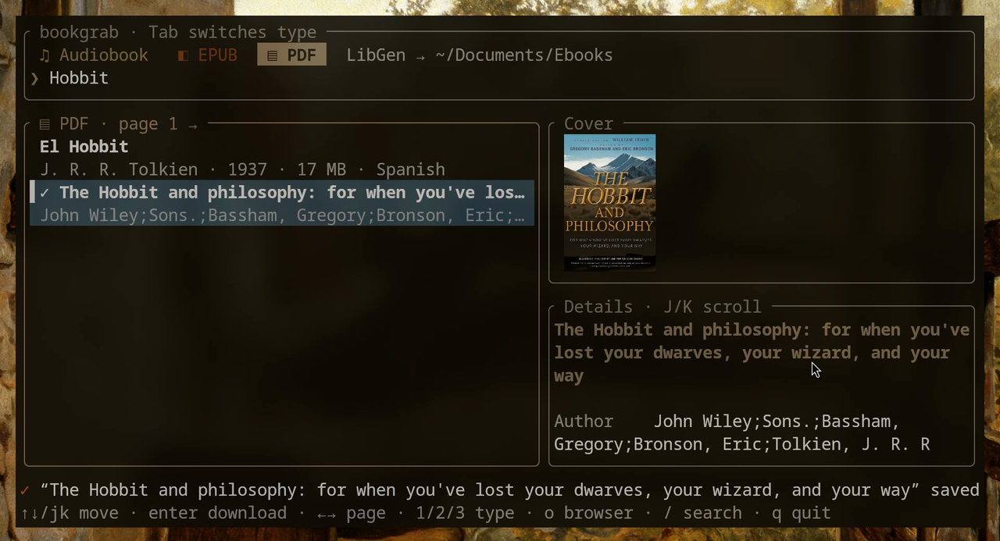

# bookgrab

**Find audiobooks and ebooks from your terminal.** Pick what you're looking for
(**audiobook**, **EPUB** or **PDF**), type a title, browse the results with cover art and
details, and press Enter:

| Type | Source | What Enter does |
|---|---|---|
| ♫ Audiobook | [AudiobookBay](https://audiobookbay.lu) | sends the magnet to qBittorrent → `~/Documents/Audiobooks` |
| ◧ EPUB | [Library Genesis](https://libgen.li) | downloads the file → `~/Documents/Ebooks` |
| ▤ PDF | [Library Genesis](https://libgen.li) | downloads the file → `~/Documents/Ebooks` |



<sub>Full quality: [docs/demo.mp4](docs/demo.mp4)</sub>

## Features

- Three search types, colour-coded tabs, switched with `Tab`
- Language filter (English, Serbian, Croatian, German…) for all three types, switched with `Ctrl+L`
- Interactive terminal UI with a search box, a result list, cover art and book details
  (author, narrator, format, size, description; series, publisher, year and pages for ebooks)
- Cover images use the kitty graphics protocol, Sixel or iTerm2, which covers kitty,
  Ghostty, WezTerm, Konsole, foot, xterm and others. Terminals without image support get
  a Unicode block-character preview.
- Audiobooks: one key sends the magnet to qBittorrent, saving to `~/Documents/Audiobooks`
  in the `audiobooks` category
- Ebooks: direct download with a progress indicator, saved as `Author - Title.epub`/`.pdf`
- No account needed. Magnet links are built from the info hash and trackers on the book page.
- Vim-style and arrow-key navigation, with pagination through all results

## Screenshots

| Start screen: pick a type | ♫ Audiobook results |
|---|---|
|  |  |
| **◧ EPUB results** | **▤ PDF saved to ~/Documents/Ebooks** |
|  |  |

## Requirements

- **[qBittorrent](https://www.qbittorrent.org/) is required for audiobooks.** bookgrab finds
  audiobooks and hands them over, and qBittorrent does the actual downloading. Ebooks
  (EPUB/PDF) are downloaded by bookgrab itself, so they don't need qBittorrent. Either the desktop app
  (`qbittorrent`) or the headless version (`qbittorrent-nox`) works; see
  [qBittorrent setup](#qbittorrent-setup).
- For cover images, a terminal with graphics support (kitty, Ghostty, WezTerm, Konsole,
  foot…). Other terminals work too, with a lower-resolution preview.

## Installation

### Prebuilt binary (any Linux distribution)

Each [release](https://github.com/offluencer-com/bookgrab/releases) has a static x86_64
binary that runs on any Linux distribution, with no extra libraries needed:

```sh
curl -L https://github.com/offluencer-com/bookgrab/releases/latest/download/bookgrab-x86_64-linux.tar.gz | tar xz bookgrab
mkdir -p ~/.local/bin
mv bookgrab ~/.local/bin/
```

Make sure `~/.local/bin` is in your `PATH`. To update, run the same commands again.

### With Cargo

If you have [Rust](https://rustup.rs) installed:

```sh
cargo install --git https://github.com/offluencer-com/bookgrab
```

This puts the `bookgrab` binary in `~/.cargo/bin`, so make sure that directory is in your `PATH`.

### Arch Linux (AUR)

An AUR package is coming soon. Until then, use the prebuilt binary above. To install
qBittorrent:

```sh
sudo pacman -S qbittorrent
```

## Usage

```sh
bookgrab                         # open bookgrab (audiobooks selected)
bookgrab lord of the rings       # search audiobooks right away
bookgrab --epub lord of the rings  # search EPUB ebooks right away
bookgrab --pdf linux kernel      # search PDFs right away
bookgrab --config                # print the config file location
bookgrab --help
```

`-a`/`--audio`, `-e`/`--epub` and `-p`/`--pdf` only choose the starting type: you can
switch any time inside the app.

### Keys

**Search box**

| Key | Action |
|---|---|
| type | enter a title or author |
| `Enter` | search |
| `Tab` / `Shift+Tab` | switch type: Audiobook → EPUB → PDF (searches again if there's a query) |
| `Ctrl+L` | change the language filter (searches again) |
| `↓` / `Esc` | jump to the results |
| `Esc` (no results yet) | quit |

**Results list**

| Key | Action |
|---|---|
| `j` / `k` or `↓` / `↑` | move down / up |
| `PageDown` / `PageUp` | move 10 results at once |
| `g` / `G` or `Home` / `End` | first / last result |
| `Enter` or `d` | **download**: audiobook → qBittorrent, ebook → saved to `~/Documents/Ebooks` |
| `1` / `2` / `3` | switch to Audiobook / EPUB / PDF and search again |
| `L` or `Ctrl+L` | change the language filter: All → English → Serbian → … |
| `Shift+J` / `Shift+K` | scroll the description |
| `l` / `n` / `→` | next page of results |
| `h` / `p` / `←` | previous page |
| `o` | open the book page in your browser |
| `/`, `s` or `Tab` | back to the search box |
| `q` / `Esc` | quit |
| `Ctrl+C` | quit (anywhere) |

The bottom line shows what is happening: search status, download progress
(`↓ Downloading … 45%`) and the result (`✓ … added via qBittorrent`, `✓ … saved to …`).
Books you've already sent or saved get a `✓` in the list.

## Configuration

`~/.config/bookgrab/config.toml` is created on first run:

```toml
[abb]
base_url = "https://audiobookbay.lu"   # change this when the site moves to a new domain
username = ""                          # optional, the site currently works without login
password = ""

[qbittorrent]
mode = "auto"                          # auto | webui | cli
webui_url = "http://localhost:8080"
username = ""                          # Web UI login, if enabled
password = ""
category = "audiobooks"
save_path = "~/Documents/Audiobooks"

[libgen]
base_url = "https://libgen.li"         # mirrors: libgen.li, libgen.gl, libgen.la, libgen.bz
save_path = "~/Documents/Ebooks"

[search]
language = "All"                       # language filter at startup
languages = ["English", "Serbian", "Croatian", "Bosnian", "German", "French", "Spanish", "Italian", "Russian"]
```

`languages` is the list `Ctrl+L` cycles through after "All"; add or remove any language
as the sites spell it (e.g. "Portuguese", "Dutch").

Sections added by newer versions are appended to your config automatically.

### qBittorrent setup

bookgrab can reach qBittorrent in two ways:

| Mode | How it works | Setup |
|---|---|---|
| `cli` | runs `qbittorrent --save-path=… <magnet>`, which passes the torrent to the running app or starts it | none |
| `webui` | uses the qBittorrent Web UI API. Works with `qbittorrent-nox`, servers and remote machines. | in qBittorrent: *Tools → Options → Web UI*, enable it and fill in `webui_url`, `username` and `password` |
| `auto` (default) | tries the Web UI first and falls back to `cli` | none |

With the desktop app, the default settings work out of the box.

## Troubleshooting

- **No results or connection errors**: AudiobookBay changes domains from time to time.
  Open the site in a browser, check the current address and update `base_url` in the config.
- **Ebook search fails or times out**: LibGen is slow (several seconds per page) and
  mirrors come and go. Set `base_url` under `[libgen]` to another mirror, e.g. `https://libgen.gl`.
- **Few results**: neither site can filter by file type or language, so bookgrab filters
  each page itself and skips up to 3 pages ahead. Press `→` to keep looking, set the
  language back to "All", or make the query more specific.
- **"could not run `qbittorrent`"**: qBittorrent isn't installed, or you use
  `qbittorrent-nox`. In that case set `mode = "webui"`.
- **Covers look blocky**: your terminal has no graphics protocol, so bookgrab falls
  back to Unicode blocks. Try kitty, Ghostty or WezTerm.

## Roadmap

- [x] AudiobookBay search, details, covers and qBittorrent integration
- [x] Ebooks (EPUB/PDF) from Library Genesis
- [ ] Desktop GUI

## Development

```sh
cargo run -- dune                     # run from source
cargo test                            # parser tests
cargo test -- --ignored --nocapture   # check the parser against the live site
```

## Disclaimer

bookgrab is a search client and does not host any content. You are responsible for
complying with copyright law in your country.

## License

[MIT](LICENSE)
