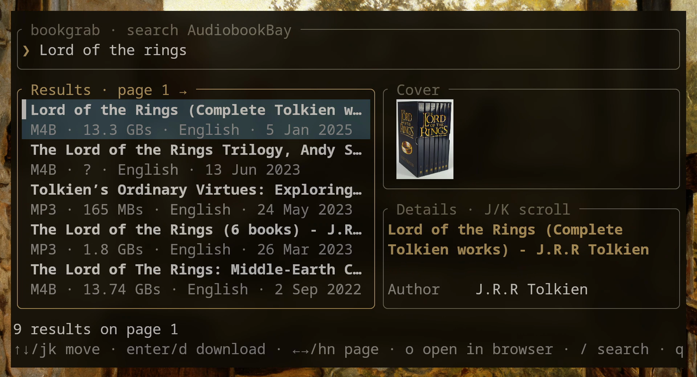
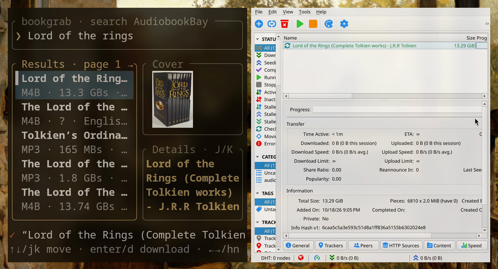

# bookgrab

**Search [AudiobookBay](https://audiobookbay.lu) from your terminal and send audiobooks
straight to qBittorrent.** Type a title, browse the results with cover art and details,
and press Enter to start the download.


<sub>Full quality: [docs/demo.mp4](docs/demo.mp4)</sub>

## Features

- Interactive terminal UI with a search box, a result list, cover art and book details
  (author, narrator, format, size, description)
- Cover images use the kitty graphics protocol, Sixel or iTerm2, which covers kitty,
  Ghostty, WezTerm, Konsole, foot, xterm and others. Terminals without image support get
  a Unicode block-character preview.
- One key sends the magnet to qBittorrent, saving to `~/Documents/Audiobooks` in the
  `audiobooks` category
- No account needed. Magnet links are built from the info hash and trackers on the book page.
- Vim-style and arrow-key navigation, with pagination through all results

## Screenshots

| Search results with cover and details | Sent to qBittorrent |
|---|---|
|  |  |

## Requirements

- **[qBittorrent](https://www.qbittorrent.org/) is required.** bookgrab finds books and
  hands them over, and qBittorrent does the actual downloading. Either the desktop app
  (`qbittorrent`) or the headless version (`qbittorrent-nox`) works; see
  [qBittorrent setup](#qbittorrent-setup).
- For cover images, a terminal with graphics support (kitty, Ghostty, WezTerm, Konsole,
  foot…). Other terminals work too, with a lower-resolution preview.

## Installation

### Arch Linux (AUR)

```sh
yay -S bookgrab
```

`paru -S bookgrab` or any other AUR helper works too. If qBittorrent isn't installed yet:

```sh
sudo pacman -S qbittorrent
```

### From source (any Linux distribution)

You need [Rust](https://rustup.rs) (`cargo`):

```sh
git clone https://github.com/offluencer-com/bookgrab.git
cd bookgrab
cargo install --path .
```

This puts the `bookgrab` binary in `~/.cargo/bin`, so make sure that directory is in your `PATH`.

## Usage

```sh
bookgrab                    # open bookgrab
bookgrab lord of the rings  # open it and search right away
bookgrab --config           # print the config file location
bookgrab --help
```

### Keys

**Search box**

| Key | Action |
|---|---|
| type | enter a title or author |
| `Enter` | search |
| `Tab` / `↓` / `Esc` | jump to the results |
| `Esc` (no results yet) | quit |

**Results list**

| Key | Action |
|---|---|
| `j` / `k` or `↓` / `↑` | move down / up |
| `PageDown` / `PageUp` | move 10 results at once |
| `g` / `G` or `Home` / `End` | first / last result |
| `Enter` or `d` | **download**: send the selected book to qBittorrent |
| `Shift+J` / `Shift+K` | scroll the description |
| `l` / `n` / `→` | next page of results |
| `h` / `p` / `←` | previous page |
| `o` | open the book page in your browser |
| `/`, `s` or `Tab` | back to the search box |
| `q` / `Esc` | quit |
| `Ctrl+C` | quit (anywhere) |

The bottom line shows what happened: the search status, and `✓ … added via qBittorrent`
once a book has been sent.

## Configuration

`~/.config/bookgrab/config.toml` is created on first run:

```toml
[abb]
base_url = "https://audiobookbay.lu"   # change this when the site moves to a new domain
username = ""                          # optional, the site currently works without login
password = ""

[qbittorrent]
mode = "auto"                          # auto | webui | cli
webui_url = "http://localhost:8080"
username = ""                          # Web UI login, if enabled
password = ""
category = "audiobooks"
save_path = "~/Documents/Audiobooks"
```

### qBittorrent setup

bookgrab can reach qBittorrent in two ways:

| Mode | How it works | Setup |
|---|---|---|
| `cli` | runs `qbittorrent --save-path=… <magnet>`, which passes the torrent to the running app or starts it | none |
| `webui` | uses the qBittorrent Web UI API. Works with `qbittorrent-nox`, servers and remote machines. | in qBittorrent: *Tools → Options → Web UI*, enable it and fill in `webui_url`, `username` and `password` |
| `auto` (default) | tries the Web UI first and falls back to `cli` | none |

With the desktop app, the default settings work out of the box.

## Troubleshooting

- **No results or connection errors**: AudiobookBay changes domains from time to time.
  Open the site in a browser, check the current address and update `base_url` in the config.
- **"could not run `qbittorrent`"**: qBittorrent isn't installed, or you use
  `qbittorrent-nox`. In that case set `mode = "webui"`.
- **Covers look blocky**: your terminal has no graphics protocol, so bookgrab falls
  back to Unicode blocks. Try kitty, Ghostty or WezTerm.

## Roadmap

- [x] AudiobookBay search, details, covers and qBittorrent integration
- [ ] Ebooks (EPUB/PDF) as a second source
- [ ] Desktop GUI

## Development

```sh
cargo run -- dune                     # run from source
cargo test                            # parser tests
cargo test -- --ignored --nocapture   # check the parser against the live site
```

## Disclaimer

bookgrab is a search client and does not host any content. You are responsible for
complying with copyright law in your country.

## License

[MIT](LICENSE)
