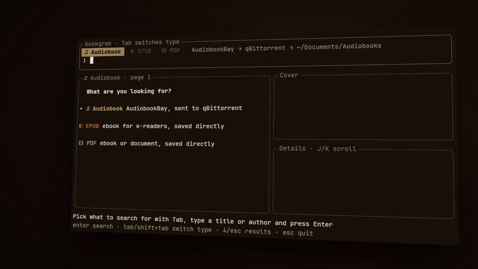
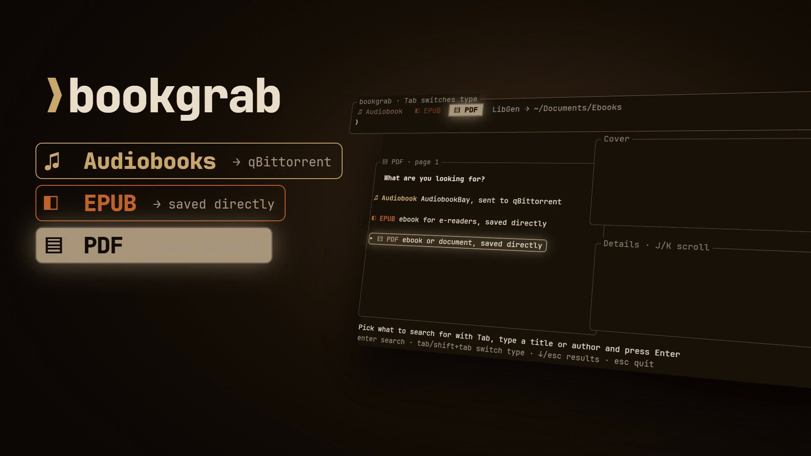

# bookgrab

**Find audiobooks and ebooks from your terminal.** Pick a type, type a title, press Enter.

<a href="docs/promo.mp4"></a>

| Type | Searches | Enter does |
|---|---|---|
| ♫ Audiobook | AudiobookBay | sends it to qBittorrent → `~/Documents/Audiobooks` |
| ◧ EPUB | Library Genesis | downloads it → `~/Documents/Ebooks` |
| ▤ PDF | Library Genesis | downloads it → `~/Documents/Ebooks` |

Cover art right in the terminal (kitty, Ghostty, WezTerm, Konsole, foot…), a language filter, vim keys,
no account needed.

> **Use it for books you're allowed to download**: public-domain classics, open-access titles, books you own.
> bookgrab is only a search client. It hosts nothing, and you are responsible for following copyright law
> where you live.

| | |
|---|---|
|  |  |


## Install

Linux, x86_64. Download the static binary from the [latest release](https://github.com/offluencer-com/bookgrab/releases/latest):

```sh
curl -L https://github.com/offluencer-com/bookgrab/releases/latest/download/bookgrab-x86_64-linux.tar.gz | tar xz bookgrab
mkdir -p ~/.local/bin && mv bookgrab ~/.local/bin/
```

Or build it with Rust: `cargo install --git https://github.com/offluencer-com/bookgrab`

Audiobooks also need [qBittorrent](https://www.qbittorrent.org/) (`sudo pacman -S qbittorrent`). Ebooks don't.

## Use

```sh
bookgrab                    # open it
bookgrab moby dick          # search audiobooks right away
bookgrab --epub moby dick   # … or EPUB (--pdf for PDF)
```

| Key | Does |
|---|---|
| `Tab` | switch type: Audiobook → EPUB → PDF |
| `Enter` | search / download the selected book |
| `j` `k` or `↑` `↓` | move through results |
| `←` `→` | previous / next page |
| `Ctrl+L` | language filter |
| `o` | open the book page in your browser |
| `q` | quit |

The bottom line of the app always shows the keys for where you are.

## Settings

`~/.config/bookgrab/config.toml` is created on first run (`bookgrab --config` prints where). Change it when:

- a site moves to a new address: `base_url` under `[abb]` or `[libgen]` (LibGen mirrors: libgen.li, libgen.gl, libgen.la, libgen.bz);
- you use `qbittorrent-nox` or a remote qBittorrent: `mode = "webui"` and the Web UI address and login under `[qbittorrent]`;
- you want other folders or languages: `save_path`, `languages`.

## Problems?

- **No results:** the site may have moved; check its current address and update `base_url`.
- **LibGen is slow:** it often takes several seconds per page; try another mirror.
- **"could not run qbittorrent":** install qBittorrent, or set `mode = "webui"` for `qbittorrent-nox`.
- **Blocky covers:** your terminal has no image support; try kitty, Ghostty or WezTerm.

## Development

`cargo run -- dune` runs it from source, `cargo test` runs the parser tests.

## License

[MIT](LICENSE). Trailer made with [huashu-motion](https://github.com/alchaincyf/huashu-motion); covers and painting
(Carl Spitzweg, *The Bookworm*, c. 1850) are public domain from Wikimedia Commons; piano samples: Salamander Grand
Piano V3 by Alexander Holm (CC BY 3.0).
